```mermaid
flowchart TB
    subgraph Client["Presentation Layer (SPA — React 18 + Vite 6 + TypeScript 5.6)"]
        ThreeCanvas["Three.js 3D WebGL Saigon Cityscape (CityHero3D)"]
        ChatConcierge["AI Concierge Chat (/chat)"]
        PlannerWizard["Smart Trip Planner (/planner)"]
        LaserTimeline["Laser Timeline & 4 KPI Cards (/itinerary)"]
        CompareView["Side-by-side Compare (/compare)"]
        ProviderPortalUI["Provider Portal (/provider-portal)"]
        AdminPortalUI["Admin Portal (/admin)"]
        MapAdapter["Leaflet + CartoDB (Voyager / Dark Matter)"]
        Map3DViewer["3D Landmark Viewer (/map-3d) — GLB models"]
        MockEngine["Offline Heuristic Fallback Engine"]
    end

    subgraph Gateway["Application Layer (FastAPI — Python 3.12+)"]
        AuthMW["RBAC Auth Middleware — HTTP-only Cookie + Google OAuth PKCE"]
        RateLimitMW["Rate Limit Middleware (Redis)"]
        API["14 FastAPI Route Modules"]
        HeuristicSolver["Deterministic Heuristic Planner (planner_service.py)"]
        ReplanEngine["Dynamic Replanning Service (replanning_service.py)"]
        PromptEngine["Prompt Runner — PRD 3.0 Manifest v3_0_0 (8 prompts)"]
        LLMAdapter["LLM Provider Adapter (OpenAI / Gemini compatible)"]
        MLRanker["XGBoost ML Ranker (ml_ranker_service.py)"]
        FloodRisk["Flood Risk Classifier (flood_model_service.py)"]
        E5Search["Multilingual E5 Semantic Search (e5_search_service.py)"]
        RoutingAdapter["Goong Directions & Forward Geocoding (routing_service.py)"]
        BookingEngine["Seat Hold & Payment Gateway (ticket_service.py)"]
        BotService["Telegram Bot & n8n Sync (bot_service.py)"]
        OutboxWorker["Transactional Email Outbox Worker (worker.py)"]
    end

    subgraph Persistence["Persistence & Intelligence Layer"]
        PostGIS[("PostgreSQL 16 + PostGIS 3.4")]
        Redis[("Redis — Rate Limit & Cache")]
        LocalModels[("Local Model Artifacts:\nXGBoost Ranker / E5 / Flood Classifier")]
        PromptCatalog[("Versioned JSON Prompts — prompts/")]
        SQLite[("SQLite — Dev/Demo mode")]
    end

    Client --> AuthMW
    AuthMW --> RateLimitMW
    RateLimitMW --> API

    API --> HeuristicSolver
    API --> ReplanEngine
    API --> PromptEngine
    API --> MLRanker
    API --> FloodRisk
    API --> E5Search
    API --> BookingEngine
    API --> BotService

    PromptEngine --> LLMAdapter
    HeuristicSolver --> MLRanker
    HeuristicSolver --> RoutingAdapter
    ReplanEngine --> PromptEngine
    ReplanEngine --> MLRanker

    API --> PostGIS
    API --> Redis
    BookingEngine --> PostGIS
    E5Search --> LocalModels
    MLRanker --> LocalModels
    FloodRisk --> LocalModels
    PromptEngine --> PromptCatalog
    OutboxWorker --> PostGIS

    MockEngine -. Offline fallback .-> Client
```

# Local Explorer AI — Đặc tả Kiến trúc Hệ thống Kỹ thuật

## 1. Tổng quan Kiến trúc (Executive Summary)

**Local Explorer AI** là nền tảng khám phá đô thị thông minh và lập lịch trình có khung giờ thực tế (Slot-aware) tại TP. Hồ Chí Minh. Hệ thống được thiết kế để giải quyết triệt để khoảng cách giữa biểu diễn bản đồ tĩnh và khả năng tham gia thực tế của du khách.

**Nguyên lý cốt lõi của kiến trúc:**
```text
POI (Địa điểm) ──> Experience (Hoạt động) ──> ExperienceSlot (Khung giờ + Sức chứa) ──> Itinerary (Lịch trình)
```

---

## 2. Sơ đồ Kiến trúc Tổng thể (High-Level Architecture)



---

## 3. Đặc tả Chi tiết Từng Tầng (4-Tier Layer Specification)

### 3.1 Presentation Layer — Frontend SPA

- **Framework**: React 18.3 + Vite 6.0 + TypeScript 5.6
- **Đồ họa 3D**: Three.js WebGL dựng Digital Twin Sài Gòn: toà cao ốc ánh sáng neon, dòng sông Sài Gòn phản quang, điểm ghim POI radar-pulse, camera thị sai đa hướng. Trình xem 3D Landmark (GLB) tại `/map-3d`.
- **Bản đồ**: Leaflet + CartoDB Voyager (Sáng) / Dark Matter (Tối) + Goong polylines thực tế.
- **Thiết kế**: Vanilla CSS + Tailwind CSS utilities, Glassmorphism (`backdrop-filter: blur(20px)`), hiệu ứng neon, `TiltCard3D` (specular glare overlay).
- **Chủ đề kép**: Warm Light Theme (ban ngày) và Nocturnal Emerald Dark Theme (cyberpunk huyền bí).
- **Song ngữ**: VI/EN toàn diện với `LanguageSwitcher` và từ điển `i18n.ts`.
- **Phân quyền**: `CustomerRoute`, `RoleRoute`, `RoleHome` phân luồng Traveler / Provider / Admin.
- **Offline Resilience**: `Offline Heuristic Mock Engine` tự kích hoạt khi backend không khả dụng.

### 3.2 Application Layer — FastAPI Backend

- **Framework**: Python 3.12+ + FastAPI 0.142+ + Pydantic v2 + Uvicorn (ASGI)
- **14 Route Modules** (`apps/api/app/api/routes/`):

| Module | Prefix | Chức năng chính |
|---|---|---|
| `health.py` | `/health`, `/ready` | Liveness & Readiness probe |
| `ops.py` | `/api/ops/*` | Giám sát vận hành, outbox, events |
| `auth.py` | `/api/auth/*` | Đăng ký, đăng nhập, Google OAuth PKCE |
| `catalog.py` | `/api/pois`, `/api/experiences`, `/api/experience-search` | Danh mục POI, trải nghiệm, tìm kiếm E5 |
| `planner.py` | `/api/itineraries/*` | Lập lịch trình, CRUD, version, share, feedback |
| `bookings.py` | `/api/bookings/*` | Giữ chỗ 15p, VNPay, MoMo IPN |
| `routing.py` | `/api/routing/*`, `/api/geocoding/*` | Goong Directions & Forward Geocoding |
| `ai.py` | `/api/ai/*` | Prompt tools, replan advice, tagging, XAI |
| `chat.py` | `/api/chat/*` | AI Concierge chatbot |
| `ml.py` | `/api/ml/*` | ML status, rank-experiences, flood-risk |
| `provider.py` | `/api/providers/*` | Quản lý POI, experiences, slots, evidence, slot-assistant |
| `admin.py` | `/api/admin/*` | KPI dashboard, moderation, merge, staging, integrations, audit |
| `admin_bot.py` | `/api/admin/bot/*`, `/api/admin/system-settings` | Telegram Bot, n8n, system settings |
| `models_3d.py` | `/api/models-3d/*` | 3D Landmark calibration & management |

- **Middleware chuỗi**:
  1. `request_id_middleware`: X-Request-ID tracing
  2. Rate Limit Middleware (Redis — phân category: auth / chat / general)
  3. CORS Middleware (origin whitelist)

### 3.3 Heuristic Planner Engine

Thuật toán xác định 3 bước, không dùng LLM tự do, đảm bảo zero hallucination:

```text
Input: [T_start, T_end, Budget_VND, Group_Size, Intent_Weights, Transport_Mode, Locked_IDs, Origin/Dest]
         │
         ▼
Bước 1 — Feasibility Pruning:
  - Loại ca ngoài [T_start, T_end] hoặc đã hết chỗ (status = full | cancelled)
  - Loại trải nghiệm vượt ngân sách bình quân (price > Budget / Group_Size)
  - Giữ nguyên locked_experience_ids theo yêu cầu người dùng
         │
         ▼
Bước 2 — Multi-objective Scoring & ML Tie-breaking:
  - Score = w1 * intent_match + w2 * slot_freshness + w3 * cost_efficiency
  - Khi đồng điểm: Kích hoạt XGBoost Ranker (15 đặc trưng ranker-features-v2)
  - Tự động fallback về Rule Baseline nếu model không đạt ngưỡng SHA-256
         │
         ▼
Bước 3 — Sequential Routing Optimization (Goong API):
  - Tra cứu địa chỉ xuất phát/đích qua Goong Forward Geocoding
  - Lấy ETA, quãng đường và hình học tuyến từ Goong Directions API
  - Tính buffer thời gian di chuyển + kiểm tra giờ về deadline
         │
         ▼
Output:
  - ItineraryStops có thứ tự thời gian + Feasibility Status
  - Reason Codes + Explanation XAI (lưu decision_logs)
  - Thống kê tổng di chuyển, chi phí, số điểm dừng
```

### 3.4 Dynamic Replanning Service

- **Trigger**: Sự kiện `SLOT_CANCELLED` từ đối tác hoặc `WEATHER_ALERT` từ AI Weather Advisor.
- **Quy trình**: Solver lọc ứng viên thay thế khả thi → `REPLAN_ADVISOR` prompt đề xuất phương án tối ưu → Hiển thị XAI giải thích → Atomic update khi xác nhận + tăng version.

### 3.5 Persistence Layer

- **Cơ sở dữ liệu**: PostgreSQL 16 + PostGIS 3.4 (production) / SQLite 3 (development/demo).
- **Cột địa lý**: `pois.geom` kiểu `geography(POINT, 4326)` với GIST spatial index.
- **ORM**: SQLAlchemy 2.0 (synchronous engine) + GeoAlchemy2 + Alembic.
- **12 Migration versions**: `0001_initial` → `0012_normalize_slot_timestamps_to_utc`.
- **Redis**: Rate limiting phân category + optional API response caching.

---

## 4. Mô hình Dữ liệu Cốt lõi (Core Data Model)

```text
User (RBAC: traveler|provider|admin)
  └──> Itinerary ──> ItineraryStop <── ExperienceSlot <── Experience <── POI <── Provider
         │               │                  │                 │               │
         ├── Version      └── Booking ───────┘          Evidence         (location geom)
         ├── Feedback          │
         └── DecisionLog  ├── PaymentTransaction (VNPay|MoMo IPN)
                          ├── BookingEvent (audit trail)
                          └── EmailOutbox (worker notification)

IntegrationSetting (Fernet-encrypted: vnpay|momo|goong|gemini|google)
AuditLog (admin & provider action trail)
PlaceImportStaging (import buffer for batch place onboarding)
```

---

## 5. Cơ chế Bảo mật & Toàn vẹn Dữ liệu (Security & Safety)

| Cơ chế | Triển khai |
|---|---|
| **Session Management** | HTTP-only Cookie (`le_session`), chống XSS |
| **Password Security** | Argon2 / PBKDF2 hashing |
| **Google OAuth** | PKCE flow — không cần client_secret trên trình duyệt |
| **Secret Vault** | Fernet AES-128-CBC cho mọi integration key trong `integration_settings` |
| **Seat Hold Isolation** | `SELECT ... FOR UPDATE` row-level lock trên PostgreSQL |
| **Payment Integrity** | HMAC-SHA512 (VNPay) + HMAC-SHA256 (MoMo), IPN server-to-server |
| **ML Integrity** | SHA-256 checksum kiểm tra model binary trước khi load |
| **Simulated Data Boundary** | `verification_status = 'simulated'` không thể đặt chỗ/thanh toán thật |
| **Rate Limiting** | Redis sliding window, phân category: auth/chat/general |
| **Audit Trail** | `audit_logs` ghi vết mọi can thiệp quản trị |
| **Error Envelope** | Mọi lỗi trả về chuẩn `{ "error": { "code", "message", "details", "request_id" } }` |

---

## 6. Luồng Thanh toán End-to-End (Payment Flow)

```text
Traveler chọn slot → POST /api/bookings/hold
  → SELECT ... FOR UPDATE (15-minute lock)
  → Provider nhận thông báo → POST /api/bookings/{id}/decision (accept/reject)
  → accept → POST /api/bookings/{id}/payment-link (VNPay hoặc MoMo)
  → User redirect → thanh toán gateway
  → Gateway gọi IPN webhook → POST /api/bookings/vnpay/ipn hoặc /momo/ipn
  → Verify HMAC signature → UPDATE booking.status = confirmed
  → EmailOutbox enqueue → Worker gửi email xác nhận
```

---

## 7. Sơ đồ Luồng Dữ liệu ML (ML Data Flow)

```text
[data/raw/hcmc_flood_reports_2002_2026.csv]
  └──> [scripts/build_flood_report_weak_labels.mjs]
       └──> [data/experimental/flood_training_weak_labels.csv]
            └──> [notebooks/Flood_Report_Weak_Label_Experiment_Colab.ipynb] (research only)
                 └──> [models/flood-report-experiment/report_presence_model.joblib]

[data/experimental/ranking/ranking_candidates_labeled.csv]  ← OSM 3,828 rows
[data/training/experience_ranker_verified_template.csv]     ← human-labeled
  └──> [scripts/train_experience_ranker.py]
       └──> [models/ai-ranker/xgboost_ranker.json]          NDCG@5 = 0.9516
            └──> [apps/api/app/services/ml_ranker_service.py]

[intfloat/multilingual-e5-base] ── downloaded via scripts/download_e5_model.py ──>
  └──> [models/e5/] ──> [apps/api/app/services/e5_search_service.py]
```

---

## 8. CI/CD Pipeline (GitHub Actions)

```yaml
# .github/workflows/ci.yml
Triggers: push/PR to main
Steps:
  1. Python 3.12 setup + pip install requirements*.txt
  2. ruff lint check
  3. pytest -q (22 modules, 107+ test cases)
  4. Node.js 20 + npm ci (apps/web) + npm run build
     (tự động inject @rollup/rollup-linux-x64-gnu cho CI Linux)
```

---

## 9. Docker Compose Deployment

```yaml
# docker-compose.yml (production)
Services:
  db:  PostgreSQL 16 + PostGIS 3.4
  redis: Redis 7 Alpine
  api:  FastAPI (apps/api/Dockerfile) — port 8000
  web:  React + Nginx (apps/web/Dockerfile) — port 80/443

# docker-compose.override.yml (development)
  Volumes: hot-reload mounts
  Environment: DEBUG=true, CORS allow localhost
```

---

## 10. Lưu ý Khoảng cách Tài liệu (Known Documentation Gaps)

> [!WARNING]
> - File `ARCHITECTURE.md` cũ (v1.0) mô tả `Haversine Routing Adapter` — **đã lỗi thời**. Hệ thống thực tế sử dụng **Goong Directions API** + Goong Forward Geocoding.
> - `Itinerary Rollback` được đề cập trong README nhưng rollback là thông qua Versioning (xem `/api/itineraries/{id}/versions`), không phải endpoint rollback riêng biệt.
> - Model weights (`models/ai-ranker/`, `models/e5/`, `models/flood-risk/`) không được commit vào repository. Cần tải/huấn luyện trước khi chạy ML endpoints.
> - `apps/api/local_explorer.sqlite3` là database SQLite cho môi trường dev/demo; production dùng PostgreSQL.
