# Local Explorer AI — Technical System Architecture Specification

> This is a translated historical architecture specification. It preserves the original component inventory and design details, but some model, service, endpoint, test-count, and deployment statements may be aspirational or stale. Check the current implementation and [architecture notes](docs/architecture.md) before treating a statement as live operational status.

## 1. Architecture Overview (Executive Summary)

**Local Explorer AI** is a smart urban discovery and slot-aware itinerary planning platform for Ho Chi Minh City. The system is designed to address the gap between static map representation and travelers' ability to actually participate in an experience.

**Core architectural principle:**
```text
POI (Place) ──> Experience (Activity) ──> ExperienceSlot (Time + Capacity) ──> Itinerary
```

---

## 2. High-Level Architecture Diagram

```mermaid
flowchart TB
    subgraph Client["Presentation Layer (SPA — React 18 + Vite 6 + TypeScript 5.6)"]
        ThreeCanvas["Three.js 3D WebGL Saigon Cityscape (CityHero3D)"]
        ChatConcierge["AI Concierge Chat (/chat)"]
        PlannerWizard["Smart Trip Planner (/planner)"]
        LaserTimeline["Laser Timeline & 4 KPI Cards (/itinerary)"]
        CompareView["Side-by-side Compare (/compare)"]
        ProviderPortalUI["Provider Portal (/provider-portal)"]
        AdminPortalUI["Admin Portal (/admin)"]
        MapAdapter["Leaflet + CartoDB (Voyager / Dark Matter)"]
        Map3DViewer["3D Landmark Viewer (/map-3d) — GLB models"]
        MockEngine["Offline Heuristic Fallback Engine"]
    end

    subgraph Gateway["Application Layer (FastAPI — Python 3.12+)"]
        AuthMW["RBAC Auth Middleware — HTTP-only Cookie + Google OAuth PKCE"]
        RateLimitMW["Rate Limit Middleware (Redis)"]
        API["14 FastAPI Route Modules"]
        HeuristicSolver["Deterministic Heuristic Planner (planner_service.py)"]
        ReplanEngine["Dynamic Replanning Service (replanning_service.py)"]
        PromptEngine["Prompt Runner — PRD 3.0 Manifest v3_0_0 (8 prompts)"]
        LLMAdapter["LLM Provider Adapter (OpenAI / Gemini compatible)"]
        MLRanker["XGBoost ML Ranker (ml_ranker_service.py)"]
        FloodRisk["Flood Risk Classifier (flood_model_service.py)"]
        E5Search["Multilingual E5 Semantic Search (e5_search_service.py)"]
        RoutingAdapter["Goong Directions & Forward Geocoding (routing_service.py)"]
        BookingEngine["Seat Hold & Payment Gateway (ticket_service.py)"]
        BotService["Telegram Bot & n8n Sync (bot_service.py)"]
        OutboxWorker["Transactional Email Outbox Worker (worker.py)"]
    end

    subgraph Persistence["Persistence & Intelligence Layer"]
        PostGIS[("PostgreSQL 16 + PostGIS 3.4")]
        Redis[("Redis — Rate Limit & Cache")]
        LocalModels[("Local Model Artifacts:\nXGBoost Ranker / E5 / Flood Classifier")]
        PromptCatalog[("Versioned JSON Prompts — prompts/")]
        SQLite[("SQLite — Dev/Demo mode")]
    end

    Client --> AuthMW
    AuthMW --> RateLimitMW
    RateLimitMW --> API

    API --> HeuristicSolver
    API --> ReplanEngine
    API --> PromptEngine
    API --> MLRanker
    API --> FloodRisk
    API --> E5Search
    API --> BookingEngine
    API --> BotService

    PromptEngine --> LLMAdapter
    HeuristicSolver --> MLRanker
    HeuristicSolver --> RoutingAdapter
    ReplanEngine --> PromptEngine
    ReplanEngine --> MLRanker

    API --> PostGIS
    API --> Redis
    BookingEngine --> PostGIS
    E5Search --> LocalModels
    MLRanker --> LocalModels
    FloodRisk --> LocalModels
    PromptEngine --> PromptCatalog
    OutboxWorker --> PostGIS

    MockEngine -. Offline fallback .-> Client
```



---

## 3. Four-Tier Layer Specification

### 3.1 Presentation Layer — Frontend SPA

- **Framework**: React 18.3 + Vite 6.0 + TypeScript 5.6
- **3D graphics**: Three.js WebGL renders a Saigon digital twin with neon-lit high-rises, a reflective Saigon River, radar-pulse POI pins, and multidirectional parallax camera motion. A 3D landmark viewer (GLB) is available at `/map-3d`.
- **Map**: Leaflet + CartoDB Voyager (light) / Dark Matter (dark) + actual Goong polylines.
- **Design**: Vanilla CSS + Tailwind CSS utilities, Glassmorphism (`backdrop-filter: blur(20px)`), neon effects, and `TiltCard3D` (specular glare overlay).
- **Dual themes**: Warm Light Theme (daytime) and Nocturnal Emerald Dark Theme (mysterious cyberpunk).
- **Bilingual UI**: VI/EN throughout, using `LanguageSwitcher` and the `i18n.ts` dictionary.
- **Access control**: `CustomerRoute`, `RoleRoute`, and `RoleHome` route Travelers / Providers / Admins.
- **Offline resilience**: `Offline Heuristic Mock Engine` activates automatically when the backend is unavailable.

### 3.2 Application Layer — FastAPI Backend

- **Framework**: Python 3.12+ + FastAPI 0.142+ + Pydantic v2 + Uvicorn (ASGI)
- **14 Route Modules** (`apps/api/app/api/routes/`):

| Module | Prefix | Main Function |
|---|---|---|
| `health.py` | `/health`, `/ready` | Liveness & Readiness probe |
| `ops.py` | `/api/ops/*` | Operations monitoring, outbox, events |
| `auth.py` | `/api/auth/*` | Registration, sign-in, Google OAuth PKCE |
| `catalog.py` | `/api/pois`, `/api/experiences`, `/api/experience-search` | POI catalog, experiences, E5 search |
| `planner.py` | `/api/itineraries/*` | Itinerary planning, CRUD, versions, sharing, feedback |
| `bookings.py` | `/api/bookings/*` | 15-minute holds, VNPay, MoMo IPN |
| `routing.py` | `/api/routing/*`, `/api/geocoding/*` | Goong Directions & Forward Geocoding |
| `ai.py` | `/api/ai/*` | Prompt tools, replan advice, tagging, XAI |
| `chat.py` | `/api/chat/*` | AI Concierge chatbot |
| `ml.py` | `/api/ml/*` | ML status, rank-experiences, flood-risk |
| `provider.py` | `/api/providers/*` | Manage POIs, experiences, slots, evidence, slot assistant |
| `admin.py` | `/api/admin/*` | KPI dashboard, moderation, merge, staging, integrations, audit |
| `admin_bot.py` | `/api/admin/bot/*`, `/api/admin/system-settings` | Telegram Bot, n8n, system settings |
| `models_3d.py` | `/api/models-3d/*` | 3D Landmark calibration & management |

- **Middleware chain**:
  1. `request_id_middleware`: X-Request-ID tracing
  2. Rate Limit Middleware (Redis — categories: auth / chat / general)
  3. CORS Middleware (origin whitelist)

### 3.3 Heuristic Planner Engine

The deterministic three-step algorithm does not use an unconstrained LLM for planning and is intended to prevent hallucinated plans:

```text
Input: [T_start, T_end, Budget_VND, Group_Size, Intent_Weights, Transport_Mode, Locked_IDs, Origin/Dest]
         │
         ▼
Step 1 — Feasibility Pruning:
  - Remove slots outside [T_start, T_end] or with no availability (status = full | cancelled)
  - Remove experiences exceeding the per-person budget (price > Budget / Group_Size)
  - Preserve `locked_experience_ids` as requested by the user
         │
         ▼
Step 2 — Multi-objective Scoring & ML Tie-breaking:
  - Score = w1 * intent_match + w2 * slot_freshness + w3 * cost_efficiency
  - On a tie: activate the XGBoost Ranker (15 `ranker-features-v2` features)
  - Automatically fall back to the rule baseline if the model does not meet the SHA-256 integrity check
         │
         ▼
Step 3 — Sequential Routing Optimization (Goong API):
  - Resolve origin/destination addresses through Goong Forward Geocoding
  - Retrieve ETA, distance, and route geometry from the Goong Directions API
  - Add travel-time buffers and check the return deadline
         │
         ▼
Output:
  - Time-ordered `ItineraryStops` + feasibility status
  - Reason codes + XAI explanation (stored in `decision_logs`)
  - Total travel, cost, and stop-count statistics
```

### 3.4 Dynamic Replanning Service

- **Trigger**: A `SLOT_CANCELLED` event from a partner or a `WEATHER_ALERT` event from the AI Weather Advisor.
- **Process**: The solver filters feasible replacement candidates → the `REPLAN_ADVISOR` prompt proposes an option → XAI explains it → an atomic update occurs on confirmation and increments the version.

### 3.5 Persistence Layer

- **Database**: PostgreSQL 16 + PostGIS 3.4 (production) / SQLite 3 (development/demo).
- **Geographic column**: `pois.geom` as `geography(POINT, 4326)` with a GiST spatial index.
- **ORM**: SQLAlchemy 2.0 (synchronous engine) + GeoAlchemy2 + Alembic.
- **12 Migration versions**: `0001_initial` → `0012_normalize_slot_timestamps_to_utc`.
- **Redis**: Categorized rate limiting + optional API response caching.

---

## 4. Core Data Model

```text
User (RBAC: traveler|provider|admin)
  └──> Itinerary ──> ItineraryStop <── ExperienceSlot <── Experience <── POI <── Provider
         │               │                  │                 │               │
         ├── Version      └── Booking ───────┘          Evidence         (location geom)
         ├── Feedback          │
         └── DecisionLog  ├── PaymentTransaction (VNPay|MoMo IPN)
                          ├── BookingEvent (audit trail)
                          └── EmailOutbox (worker notification)

IntegrationSetting (Fernet-encrypted: vnpay|momo|goong|gemini|google)
AuditLog (admin & provider action trail)
PlaceImportStaging (import buffer for batch place onboarding)
```

---

## 5. Security and Data Integrity

| Mechanism | Implementation |
|---|---|
| **Session Management** | HTTP-only cookie (`le_session`), protection against XSS |
| **Password Security** | Argon2 / PBKDF2 hashing |
| **Google OAuth** | PKCE flow — no `client_secret` in the browser |
| **Secret Vault** | Fernet AES-128-CBC for every integration key in `integration_settings` |
| **Seat Hold Isolation** | PostgreSQL row-level lock via `SELECT ... FOR UPDATE` |
| **Payment Integrity** | HMAC-SHA512 (VNPay) + HMAC-SHA256 (MoMo), IPN server-to-server |
| **ML Integrity** | SHA-256 checksum validates the model binary before loading |
| **Simulated Data Boundary** | `verification_status = 'simulated'` cannot be used for real booking/payment |
| **Rate Limiting** | Redis sliding window, categorized as auth/chat/general |
| **Audit Trail** | `audit_logs` records administrative actions |
| **Error Envelope** | All errors use `{ "error": { "code", "message", "details", "request_id" } }` |

---

## 6. End-to-End Payment Flow

```text
Traveler selects a slot → POST /api/bookings/hold
  → SELECT ... FOR UPDATE (15-minute lock)
  → Provider receives a notification → POST /api/bookings/{id}/decision (accept/reject)
  → accept → POST /api/bookings/{id}/payment-link (VNPay or MoMo)
  → User is redirected to pay through the gateway
  → Gateway calls the IPN webhook → POST /api/bookings/vnpay/ipn or /momo/ipn
  → Verify HMAC signature → UPDATE booking.status = confirmed
  → EmailOutbox enqueues a message → Worker sends a confirmation email
```

---

## 7. ML Data Flow Diagram

```text
[data/raw/hcmc_flood_reports_2002_2026.csv]
  └──> [scripts/build_flood_report_weak_labels.mjs]
       └──> [data/experimental/flood_training_weak_labels.csv]
            └──> [notebooks/Flood_Report_Weak_Label_Experiment_Colab.ipynb] (research only)
                 └──> [models/flood-report-experiment/report_presence_model.joblib]

[data/experimental/ranking/ranking_candidates_labeled.csv]  ← OSM 3,828 rows
[data/training/experience_ranker_verified_template.csv]     ← human-labeled
  └──> [scripts/train_experience_ranker.py]
       └──> [models/ai-ranker/xgboost_ranker.json]          NDCG@5 = 0.9516
            └──> [apps/api/app/services/ml_ranker_service.py]

[intfloat/multilingual-e5-base] ── downloaded via scripts/download_e5_model.py ──>
  └──> [models/e5/] ──> [apps/api/app/services/e5_search_service.py]
```

---

## 8. CI/CD Pipeline (GitHub Actions)

```yaml
# .github/workflows/ci.yml
Triggers: push/PR to main
Steps:
  1. Python 3.12 setup + pip install requirements*.txt
  2. ruff lint check
  3. pytest -q (22 modules, 107+ test cases)
  4. Node.js 20 + npm ci (apps/web) + npm run build
      (automatically injects @rollup/rollup-linux-x64-gnu for Linux CI)
```

---

## 9. Docker Compose Deployment

```yaml
# docker-compose.yml (production)
Services:
  db:  PostgreSQL 16 + PostGIS 3.4
  redis: Redis 7 Alpine
  api:  FastAPI (apps/api/Dockerfile) — port 8000
  web:  React + Nginx (apps/web/Dockerfile) — port 80/443

# docker-compose.override.yml (development)
  Volumes: hot-reload mounts
  Environment: DEBUG=true, CORS allow localhost
```

---

## 10. Known Documentation Gaps

> [!WARNING]
> - The older v1.0 `ARCHITECTURE.md` described a `Haversine Routing Adapter` — **that description is outdated**. The system actually uses the **Goong Directions API** + Goong Forward Geocoding.
> - `Itinerary Rollback` is mentioned in the README, but rollback is handled through versioning (see `/api/itineraries/{id}/versions`); there is no dedicated rollback endpoint.
> - Model weights (`models/ai-ranker/`, `models/e5/`, `models/flood-risk/`) are not committed to the repository. Download/train them before using the ML endpoints.
> - `apps/api/local_explorer.sqlite3` is the SQLite database for development/demo; production uses PostgreSQL.
