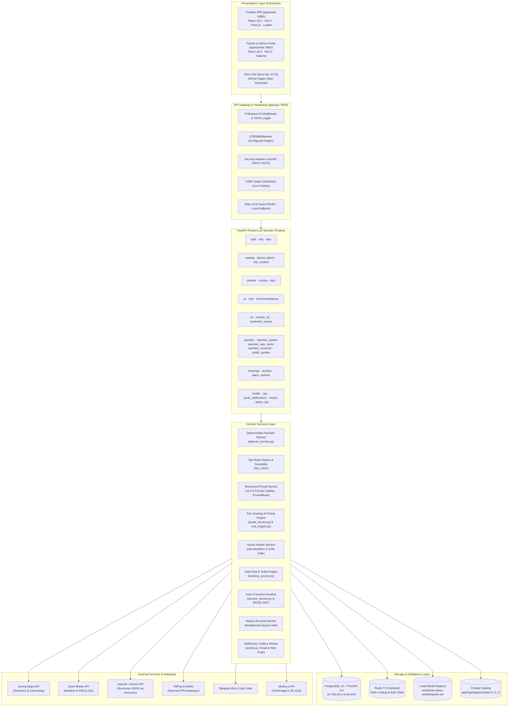
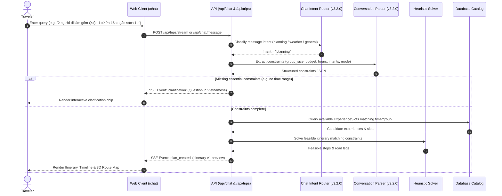
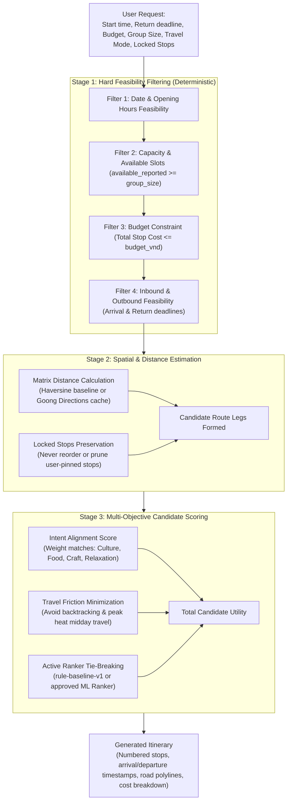
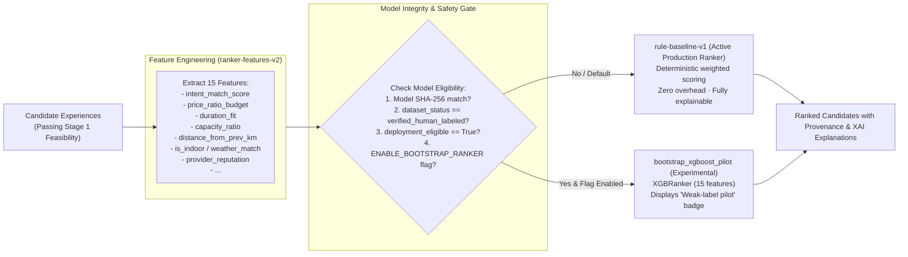
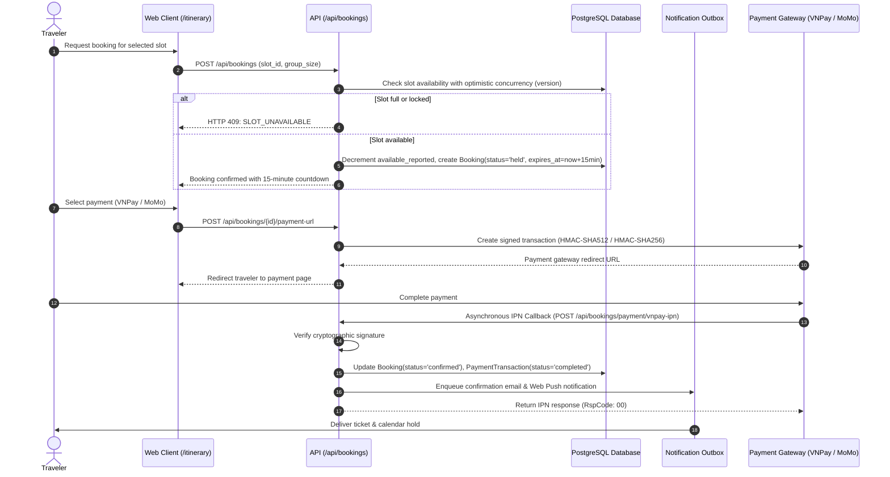
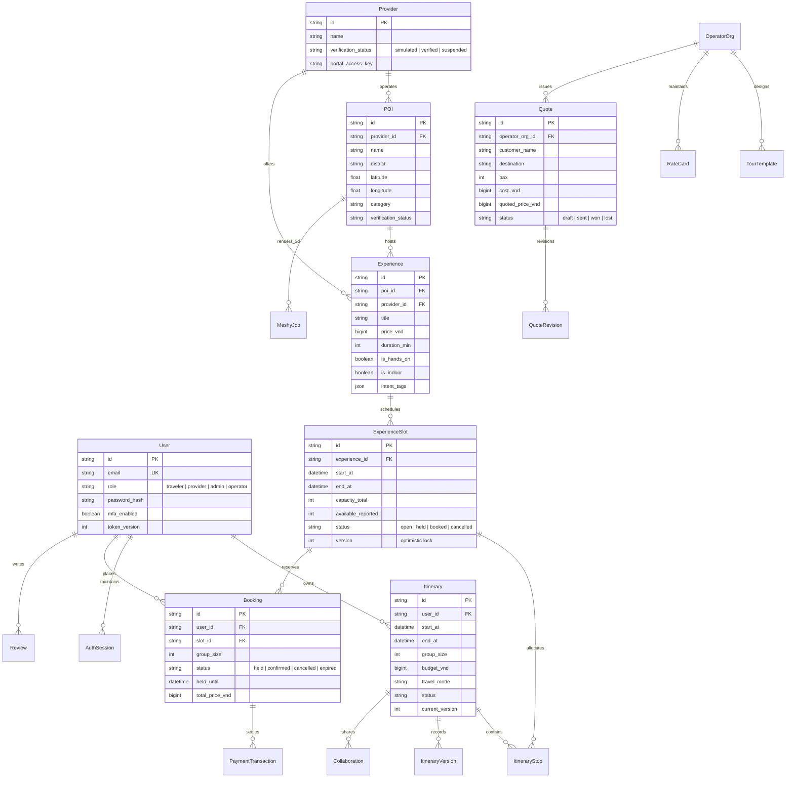
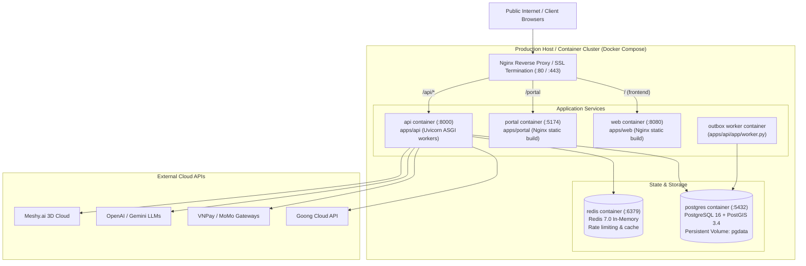

# Local Explorer AI — System Architecture Specification

> **Living Architecture Specification (Synchronized with Repository State)**  
> **Repository:** [LocalExplorerAI](https://github.com/NguyenTriBaoThang/LocalExplorerAI) · **Last Synchronized:** November 2026 · **Branch:** `main`

---

## 1. Architecture Overview

**Local Explorer AI** is an intelligent urban discovery, slot-aware itinerary planning, and experience commerce platform focused on Ho Chi Minh City. Traditional map solutions treat places as static coordinates on a 2D map. Local Explorer AI introduces a **four-layer temporal-spatial hierarchy**:

```text
Physical POI (Geographic Point)
   └── Experience (Curated Activity)
         └── ExperienceSlot (Time Window + Capacity + Status)
               └── Itinerary / Booking (Feasible Route + 15-min Seat Hold)
```

The system operates across three core domains:
1. **B2C Traveler Discovery & Smart Planning:** Multi-turn conversational AI Concierge, deterministic heuristic route optimization, 3D WebGL Digital Twin, and secure booking holds with VNPay / MoMo payments.
2. **B2B Experience Provider & Operator Platform:** Dedicated Partner Portal, slot capacity management, AI Slot Assistant, B2B tour quote generation, rate cards, and financial margin guardrails.
3. **Platform Governance & GeoAI Intelligence:** Admin moderation, fuzzy duplicate POI detection, RBAC with MFA, audit logging, Meshy 3D generative model worker, and versioned AI prompt workflows.

---

## 2. High-Level Monorepo Structure

```text
LocalExplorerAI/
├── apps/
│   ├── web/           # Public traveler SPA (React 18.3, Vite 6, TypeScript 5.6, Leaflet, Three.js)
│   ├── portal/        # Dedicated Partner & Admin Portal (React 18.3, Vite 6, Tailwind)
│   └── api/           # Backend API (FastAPI 0.142+, Python 3.12+, Uvicorn, SQLAlchemy 2.0)
├── docs-site/         # Static documentation & showcase portal (React, Vite, GitHub Pages)
├── models/            # Versioned ML models (XGBoost Ranker, Quote Win Model, E5, Flood Risk)
├── data/              # Portable catalogs, raw datasets, experimental benchmarks
├── scripts/           # DB seed scripts, crawler, ML training pipelines, test runners
└── docker-compose.yml # Container orchestration (API, Web, Portal, PostgreSQL+PostGIS, Redis)
```

---

## 3. End-to-End System Architecture (Diagram 1)



---

## 4. AI Concierge & Chat Workflow (Diagram 2)

The AI Concierge accepts natural Vietnamese travel prompts, extracts structured constraints using prompt-driven workflows, and seamlessly transitions into the heuristic route planner.



---

## 5. Smart Route Planning & Multi-Objective Optimization (Diagram 3)

The planning engine prioritizes **hard physical and temporal feasibility** before applying multi-objective ranking.



---

## 6. AI & Machine Learning Inference Architecture (Diagram 4)

Local Explorer AI separates **heuristic baseline validation** from **experimental machine learning models**. Unverified models cannot bypass hard planning constraints.



---

## 7. Booking Holds & Payment Architecture (Diagram 5)

Seat reservations follow a strict two-phase commit: a **15-minute temporary hold** followed by provider approval or online payment webhook.



---

## 8. Core Data Model (Diagram 6)



---

## 9. Deployment Architecture (Diagram 7)



---

## 10. Security & Hardening Architecture

1. **Authentication:**
   - Stateless **RS256 JWT access tokens** (15-min TTL) in HTTP-only, `SameSite=Lax` cookies (`le_at`).
   - Sliding session **opaque refresh tokens** in HTTP-only cookies (`le_rt`) with automatic reuse detection and immediate family revocation.
   - Password hashing via **Argon2id** (`argon2-cffi`) with automatic legacy re-hash migration.
   - Two-Factor Authentication (**TOTP RFC 6238**) with encrypted backup recovery codes.
2. **Access Control (RBAC):**
   - Granular, system-defined permissions registry (`app.api.permissions.P`).
   - Role-to-permission mapping backed by database with cached matrix (`sync_catalog`).
   - Strict role isolation: `traveler`, `provider`, `operator`, `admin`.
3. **Data Protection:**
   - Integration secrets (API keys, payment secrets) encrypted at rest using **Fernet AES-128-CBC** (`INTEGRATION_SECRETS_KEY`).
   - Audit logging (`AuditLog` table) recording actor, IP, user-agent, and JSON diffs for all sensitive operations.
