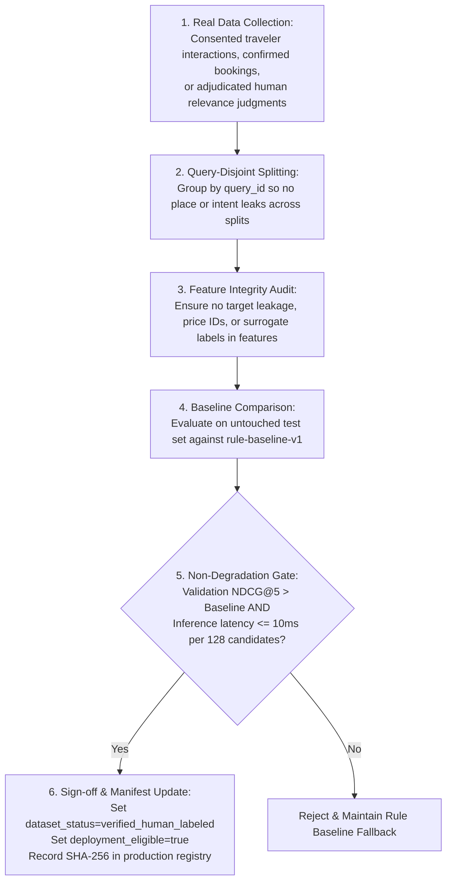

# Local Explorer AI — Model, Heuristic & AI Versioning Policy

> **Authoritative Technical Policy & Model Registry**  
> **Repository:** [LocalExplorerAI](https://github.com/NguyenTriBaoThang/LocalExplorerAI) · **Last Updated:** November 2026

---

## 1. Principles of Model Governance & Safety

Local Explorer AI adheres to strict machine learning and GeoAI safety principles:

1. **No Hallucinated Recommendations:** Machine learning models and LLMs are **never** permitted to generate or inject arbitrary locations, fictitious opening hours, or fake prices into user itineraries.
2. **Hard Feasibility Over Ranking:** Every experience candidate must first pass deterministic physical and temporal feasibility filters (opening hours, capacity, remaining budget, locked stops, travel time) before receiving a rank score.
3. **Evidence-Based Promotion Gate:** A model artifact present in the repository or file system is **not automatically production-eligible**. A model may only be promoted to production when:
   - Its training data is authenticated as `verified_human_labeled` (actual traveler interactions or adjudicated expert feedback).
   - Its evaluation split is strictly **query-disjoint** (preventing data leakage).
   - It demonstrates statistically significant NDCG@5 gain over the deterministic baseline without degrading latency.
   - Its model weights SHA-256 and feature contract schema match the API's explicit manifest.
4. **Honest Metric Reporting:** Experimental or synthetic benchmarks must never be advertised as "production accuracy". Weak-label imitations must be clearly identified with warning banners.

---

## 2. Active Model & Heuristic Inventory

| Component / Artifact | Runtime Identifier | Current Mode | Status / Eligibility | Feature Contract | Evaluation Summary |
|---|---|---|---|---|---|
| **Deterministic Intent Ranker** | `rule-baseline-v1` | **Active Production Default** | **VERIFIED (Production)** | Category & Intent Weights | Validation NDCG@5 = 1.000 (deterministic baseline) |
| **Bootstrap Experience Ranker** | `bootstrap_xgboost_pilot` | Opt-in Pilot (`ENABLE_BOOTSTRAP_RANKER=true`) | **EXPERIMENTAL (Weak-labeled)**<br/>`deployment_eligible=false` | `ranker-features-v2` (15 features) | Test NDCG@5 = 0.6667 (vs baseline 0.4932) on weak labels |
| **Tour Quote Win Predictor** | `quote-win-xgb-synthetic` | B2B Operator Pricing Optimizer | **EXPERIMENTAL (Synthetic)**<br/>`deployment_eligible=false` | `quote-win-features-v1` (18 features) | Test AUC = 0.7372, Backtest +9.5% profit on balanced strategy |
| **Multilingual Semantic Search** | `multilingual-e5-small` | CPU Vector Embeddings | **IMPLEMENTED (Weights external)** | 384-dim Dense Embeddings | Cosine similarity semantic POI matching |
| **Saigon Flood Risk Classifier** | `dataset-17-flood-risk` | Offline Research Experiment | **EXPERIMENTAL (Research)**<br/>`deployment_eligible=false` | 12 weather & geographic features | Brier score = 0.14 on synthetic formula labels |

---

## 3. Detailed Component Specifications

### 3.1. Active Production Ranker: `rule-baseline-v1`
- **Architecture:** Deterministic multi-attribute utility function implemented in pure Python (`app/services/ranking_service.py`).
- **Input:** Candidate experiences passing feasibility checks, user intent weights ($\vec{w}_{intent}$), weather condition flags, and travel distance from previous stop.
- **Scoring Function:**
  $$\text{Score}(e) = \alpha \cdot \text{Match}(e, \vec{w}) + \beta \cdot \text{WeatherFit}(e) + \gamma \cdot \text{IndoorBonus}(e) - \delta \cdot \text{DistanceNorm}(e)$$
- **Operational Guarantees:**
  - $0 \text{ ms}$ model load overhead, zero disk footprint, no external GPU or C-extension requirement.
  - Fully explainable: every score breakdown is decomposed into human-readable Vietnamese in `explanation.evidence_refs`.
  - Serves as the authoritative default for all B2C planning, tie-breaking, and replanning workflows.

### 3.2. Bootstrap Experience Ranker: `models/ai-ranker/`
- **Artifact:** `models/ai-ranker/xgboost_ranker.json` (SHA-256 validated).
- **Metadata:** `models/ai-ranker/model_metadata.json` (`dataset_status = "bootstrap_weak_labeled"`, `deployment_eligible = false`).
- **Feature Contract (`ranker-features-v2`, 15 features):**
  1. `intent_match_score` (Float): Weighted dot product of user intent and experience tags.
  2. `price_ratio_budget` (Float): Experience price as a fraction of remaining trip budget.
  3. `duration_fit` (Float): Normalized fit between activity duration and available schedule slot.
  4. `capacity_ratio` (Float): Reported available seats divided by user group size.
  5. `distance_from_prev_km` (Float): Distance from origin or previous scheduled stop.
  6. `is_indoor` (Binary): 1 if activity is sheltered from rain/heat, 0 otherwise.
  7. `weather_sensitivity_match` (Float): Interaction between weather forecast and venue type.
  8. `hands_on_priority` (Binary): User preference for hands-on cultural craft activities.
  9. `provider_verification_level` (Categorical encoded): Level of provenance documentation.
  10. `slot_lead_time_hours` (Float): Hours between booking time and activity start.
  11. `historical_completion_rate` (Float): Ratio of completed bookings.
  12. `review_sentiment_score` (Float): Aggregated sentiment polarity.
  13. `district_center_distance_km` (Float): Distance from central District 1 landmark.
  14. `meal_window_fit` (Binary): Conformance with standard lunch (11:30-13:30) or dinner hours.
  15. `group_size_suitability` (Float): Suitability factor for solo vs family groups.
- **Evaluation Evidence:**
  - Tested on 120 queries across 60 scenario families (`experience_ranker_verified.csv`).
  - Validation NDCG@5: XGBoost = 1.0000 (vs rule baseline 0.5717).
  - Test NDCG@5: XGBoost = 0.6667 (vs rule baseline 0.4932).
- **Safety Gate:** The API rejects this model by default. It can only be loaded when `ENABLE_BOOTSTRAP_RANKER=true` is explicitly set in configuration, and the API output appends an explicit weak-label warning.

### 3.3. Tour Operator Win-Probability Predictor: `models/quote-win/`
- **Artifact:** `models/quote-win/xgboost_win.json` (SHA-256 validated).
- **Objective:** Predict the probability $P(\text{win})$ that a prospective corporate or group client will accept a customized tour quote at a given quoted price per passenger.
- **Training Data:** 21,980 synthetic quote records generated by `scripts/generate_quote_history.py` (Temporal split: Train 2023–2024 [14,772 rows], Validation H1 2025 [3,586 rows], Test H2 2025 [3,622 rows]).
- **Monotonicity Constraints:** Monotonically decreasing probability as price-to-cost ratio (`price_ratio_cost`) and price-to-competitor ratio (`price_ratio_comp`) increase.
- **Features (`quote-win-features-v1`, 18 features):**
  - Group size (`pax`), trip duration (`days`), advance notice (`lead_days`), corporate/school/family segment.
  - Destination tags, weekend flag, holiday flag, Tet festive season flag, departure month.
  - Estimated competitor price index, forecasted rain probability, operator response time in hours.
  - Cost per passenger, quoted price per passenger, markup percentage, margin floor violation flag.
- **Test Set Metrics:**
  - AUC = 0.7372 (Oracle true probability AUC = 0.7450).
  - Brier score = 0.1721 (Oracle = 0.1696), Log loss = 0.5174.
- **Backtest Findings:**
  - Fixed 25% markup baseline: 5.45B VND expected profit (31.7% win rate).
  - Balanced optimizer within price support: **5.97B VND expected profit (+9.5% over baseline)** with 24.6% win rate and 26.6% average quoted margin.
  - Legacy unconstrained grid (extrapolating to 1.8x cost): Suffered -5.9% loss due to tree extrapolation error. Current optimizer strictly clamps candidate prices to `price_ratio_cost_max`.

### 3.4. Semantic Search: `models/e5/`
- **Base Architecture:** `intfloat/multilingual-e5-small` (SentenceTransformers, 384-dimensional dense vectors).
- **Application:** Asymmetric retrieval for Vietnamese cultural tourism queries (e.g., query `"làm đồ gốm truyền thống thủ công"` matching POI description passages).
- **Deployment Mode:** CPU inference using ONNX / PyTorch. Weights are excluded from the git repository to keep repo size minimal. Download script:
  ```bash
  python -m scripts.download_e5_model
  ```
- **Fallback:** If weights are missing, the system gracefully falls back to PostgreSQL Full-Text Search with Vietnamese accent normalization (`unaccent`) and category matching.

---

## 4. Promotion Criteria to Production

To transition any machine learning model from `EXPERIMENTAL` to `VERIFIED (Production)`:


