# Local Explorer AI — Kịch bản demo của Chi Thành

**Đối tượng:** Ban giám khảo / hội đồng  
**Thời lượng mục tiêu:** 7 phút  
**Thông điệp chính:** Local Explorer AI biến mong muốn đi chơi thành một lịch trình có thể giải thích; khi một ca trải nghiệm bị hủy, lịch trình có thể được đề xuất cập nhật thay vì buộc du khách tự làm lại từ đầu.

> **Nguyên tắc demo:** Theo một chuyến đi và giữ nguyên một mã lịch trình từ đầu đến cuối. Chỉ chuyển vai trò một lần, từ du khách sang đối tác rồi quay lại du khách. Không mở từng trang để đọc danh sách tính năng.

## Câu chuyện

Hai người muốn dành một ngày ở TP. Hồ Chí Minh, kết hợp ẩm thực và trải nghiệm thủ công, trong ngân sách giới hạn. Họ không chỉ cần biết địa điểm ở đâu; họ cần một lịch trình phù hợp với thời gian, phương tiện và các ca hoạt động. Khi một ca bị hủy, họ cần biết có thể thay thế bằng phương án nào.

```mermaid
flowchart LR
    A[Home 3D: nêu bài toán] --> B[Concierge: nhập mong muốn]
    B --> C[Itinerary: xem tuyến, thời gian, chi phí, lý do]
    C --> D[Provider: hủy đúng ca trong lịch]
    D --> E[SLOT_CANCELLED cho slot]
    E --> F[Ghép slot với itinerary đang dùng nó]
    F --> G[Traveler: xem cảnh báo và nhận đề xuất đổi lịch]
    G --> H[Chấp nhận: tạo phiên bản lịch mới]
    H --> I[Chia sẻ hoặc in lịch]
```

## Run of show — khoảng 7 phút

| Thời gian | Màn hình và thao tác | Lời dẫn gợi ý | Nối sang bước tiếp theo |
|---|---|---|---|
| **0:00–0:20** | Mở Home, cho thấy cityscape 3D. | “Bản đồ cho biết một nơi ở đâu. Nhưng với một trải nghiệm có khung giờ, du khách còn cần biết nó có phù hợp với thời gian và kế hoạch trong ngày hay không.” | “Mình sẽ thử bắt đầu bằng đúng cách du khách thường nói nhu cầu: một câu tự nhiên.” |
| **0:20–1:40** | Mở `/chat`. Gửi: **“Nhóm mình đi 2 người, muốn ưu tiên ẩm thực Sài Gòn và workshop thủ công, từ 09:00 đến 16:00, tổng ngân sách 1.200.000₫, di chuyển bằng xe máy.”** Chọn ngày đi; chọn điểm xuất phát và điểm về trong hai dropdown bắt buộc; quan sát bảng ràng buộc. | “Concierge chuyển lời nhắn thành số người, thời gian, ngân sách, sở thích và phương tiện. Tôi kiểm tra các điều kiện ngay trên màn hình trước khi tạo lịch.” | “Khi các điều kiện đã đủ, tôi tạo lịch trực tiếp từ cuộc trò chuyện — không phải nhập lại ở một công cụ khác.” |
| **1:40–3:30** | Bấm **Khởi tạo lịch trình ngay**. Ở `/itinerary/:id`, chỉ vào các điểm dừng, timeline, tuyến trên bản đồ, thời lượng/chi phí và phần giải thích. | “Kết quả đi qua bộ lập lịch có kiểm tra thời gian, ngân sách và khung giờ. Mỗi điểm dừng có lý do để được chọn; tuyến giúp nhìn nhanh cách các trải nghiệm nối thành một ngày.” | “Giờ mình kiểm tra điều gì xảy ra nếu một ca trong chính lịch trình này không còn khả dụng.” |
| **3:30–4:30** | Trong cửa sổ trình duyệt thứ hai đã đăng nhập vai trò provider, mở `/provider-portal`; hủy **đúng slot** đang gắn với một điểm dừng của itinerary vừa tạo. Quay lại cửa sổ traveler; chờ chu kỳ cập nhật thông báo hoặc tải lại itinerary một lần. | “Đối tác cập nhật ca từ workspace của mình. Hành động này tạo sự kiện hủy cho slot; ứng dụng tìm các itinerary có điểm dừng đang dùng slot đó.” | “Du khách có thể xử lý thay đổi ngay trên chính kế hoạch đang đi theo.” |
| **4:30–6:15** | Ở itinerary của traveler, mở cảnh báo, bấm tìm phương án thay thế, đọc một lý do của đề xuất rồi chấp nhận. Chỉ vào số phiên bản/lịch sử sau khi cập nhật. | “Solver lọc phương án theo các ràng buộc còn lại. AI hỗ trợ giải thích lựa chọn; sau khi tôi chấp nhận, lịch được cập nhật và phiên bản cũ vẫn có thể được xem lại.” | “Kết quả cuối cùng là một kế hoạch cập nhật có thể mang theo hoặc gửi cho người đi cùng.” |
| **6:15–7:00** | Dùng **Chia sẻ** nếu đang đăng nhập bằng chủ lịch; nếu không, dùng **In/Lưu PDF**. Kết thúc tại itinerary mới. | “Điểm chính không phải là từng màn hình riêng lẻ. Mong muốn, lịch trình, dữ liệu ca và thay đổi từ đối tác cùng xoay quanh một chuyến đi.” | Dừng tại lịch trình vừa cập nhật; không điều hướng sang trang admin hay mở thêm tính năng ngoài câu chuyện. |

### Câu kết 15 giây

> “Local Explorer AI kết nối khám phá với khả năng thực hiện: hiểu nhu cầu, kiểm tra lịch trình theo khung giờ và giúp du khách điều chỉnh khi ca trải nghiệm thay đổi. Một chuyến đi được tiếp tục từ cùng một kế hoạch, thay vì bắt đầu lại ở nhiều công cụ rời rạc.”

## Vì sao flow này liền mạch

| Từ | Dữ liệu / sự kiện được chuyển tiếp | Đến |
|---|---|---|
| Concierge `/chat` | Ràng buộc đã trích xuất, ngày đi, điểm xuất phát/điểm về, intent và phương tiện | Tạo một itinerary và chuyển thẳng tới `/itinerary/:id` |
| Itinerary | Các điểm dừng và `slot_id` đang được dùng | Provider cập nhật đúng ca trên `/provider-portal` |
| Provider portal | Sự kiện `SLOT_CANCELLED` cho slot bị hủy | Cảnh báo chỉ tới các itinerary có điểm dừng dùng slot đó |
| Cảnh báo itinerary | `event_id` và phiên bản itinerary hiện tại | Sinh đề xuất thay thế phù hợp với các ràng buộc còn lại |
| Người đi chấp nhận đề xuất | Phương án được chọn và `base_version` | Cập nhật itinerary, lưu phiên bản mới và giữ lịch sử phiên bản trước |
| Itinerary mới | Bản lịch đã cập nhật | Chia sẻ bằng link của chủ lịch hoặc in/lưu PDF |

## Chuẩn bị trước buổi demo

### Bắt buộc cho phần hành trình du khách

- Khởi động web và API; mở sẵn trang chủ và kiểm tra API tại `http://localhost:8000/ready`.
- Đăng nhập tài khoản traveler trước buổi demo nếu muốn chia sẻ link hoặc giữ chủ sở hữu cho lịch trình. Có thể dùng hai browser profile để giữ phiên traveler và provider riêng.
- Trong `/chat`, kiểm tra dropdown điểm đi/điểm về có dữ liệu; đây là hai trường bắt buộc dù nội dung chat đã mô tả chuyến đi.
- Chọn ngày tương lai và kiểm tra khung giờ đó có slot phù hợp trong dữ liệu đang chạy.
- Ghi lại trước một câu trả lời ngắn để xử lý khi Gemini diễn giải thiếu một ràng buộc; kiểm tra đủ số người, thời gian, ngân sách và sở thích trước khi bấm tạo lịch.

### Chỉ bật nhánh provider → replan khi đã rehearsal thành công

- Chuẩn bị tài khoản provider có quyền quản lý đúng hoạt động/slot; tài khoản provider **không được tạo sẵn trong seed demo mặc định**.
- Tạo itinerary thử trước, xác nhận itinerary có một điểm dừng gắn với slot do tài khoản provider đó quản lý, và điểm dừng không bị khóa cố định.
- Mở hai browser profile, một cho traveler và một cho provider. Hủy đúng một slot thử nghiệm, rồi xác nhận cảnh báo đến đúng itinerary và có ít nhất một phương án thay thế khả thi.
- Thực hiện rehearsal cả thao tác chấp nhận phương án; chỉ dùng bước này trong demo live nếu đã thấy itinerary đổi phiên bản thành công.
- Không thao tác trên dữ liệu đối tác thật hoặc slot của một lịch trình khác.

## Trạng thái môi trường đã kiểm tra khi soạn

Đây là snapshot của môi trường local; hãy kiểm tra lại trước mỗi buổi trình bày vì cấu hình và dữ liệu có thể thay đổi.

- Concierge báo Gemini đã cấu hình; cơ chế fallback cũng đang bật.
- Routing provider hiện là **mock**. Có thể trình bày tuyến/ETA như ước tính của bản demo, không gọi là thời gian thực từ Goong.
- API đang trả về **9 POI và 9 trải nghiệm gắn nhãn `simulated`**. Số liệu hoặc tên điểm trong flow không được giới thiệu như catalog địa điểm đã xác minh ngoài đời.
- Nút đặt chỗ bị khóa với dữ liệu demo/chưa xác minh. Trạng thái thanh toán hiện báo `checkout_enabled=false`; không demo giữ vé, VNPay, MoMo hoặc khẳng định thanh toán thành công.
- Dữ liệu seed có provider record mô phỏng, nhưng không tạo tài khoản đăng nhập provider mặc định. Cần chuẩn bị tài khoản riêng trước khi demo nhánh đổi ca.

## Nhánh dự phòng nếu đổi ca không sẵn sàng

Nếu chưa có provider account, itinerary không chứa slot phù hợp, hoặc cảnh báo/đề xuất không xuất hiện:

1. Không tiếp tục thử đăng nhập hay hủy slot khác trước hội đồng.
2. Ở lại itinerary vừa tạo; trình bày timeline, bản đồ, chi phí và lý do đề xuất.
3. Chia sẻ link nếu đang đăng nhập bằng chủ lịch; nếu không, dùng **In/Lưu PDF**.
4. Kết bằng câu: “Trong phiên demo này, tôi đã minh họa nhánh lập kế hoạch. Nhánh provider cancellation → replan cần catalog, slot và tài khoản provider được chuẩn bị; tôi sẽ không trình bày nó như một giao dịch thật khi các điều kiện đó chưa sẵn sàng.”

Nhánh dự phòng này mất khoảng **5 phút** và không giả vờ đã chạy thành công phần đổi lịch.

## Để dành cho phần hỏi đáp

Không đưa các trang dưới đây vào flow chính, vì chúng làm câu chuyện chuyển khỏi hành trình của một chuyến đi:

- `/admin`: moderation, tích hợp, audit và vận hành.
- `/map-3d`: landmark viewer; các file GLB public hiện có thể vẫn là con trỏ Git LFS chứ chưa phải binary đã tải xuống.
- ML ranker/flood-risk, OAuth và cổng thanh toán: chỉ mở nếu có câu hỏi cụ thể và trạng thái triển khai đã được xác nhận.

## Checklist ngay trước khi bước lên demo

- [ ] API `/ready` trả `ready`.
- [ ] Đã đăng nhập traveler; provider profile đã mở sẵn nếu chạy nhánh mở rộng.
- [ ] Ngày đi ở tương lai; điểm đi và điểm về đã chọn.
- [ ] Ràng buộc chat đủ; itinerary thử có tuyến và ít nhất một điểm dừng phù hợp.
- [ ] Nếu demo replan: slot gắn với itinerary, tài khoản provider sở hữu slot, và rehearsal đã hoàn tất.
- [ ] Không mở khóa bí mật/API key trước màn hình; không tuyên bố dữ liệu simulated hoặc ETA mock là dữ liệu thời gian thực.
- [ ] Nếu nhánh mở rộng lỗi, chuyển thẳng sang bản đồ/timeline và nhánh dự phòng.
