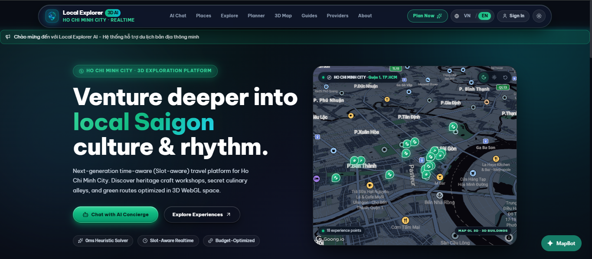
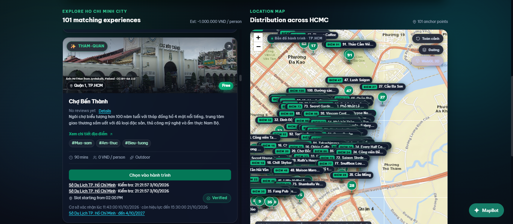
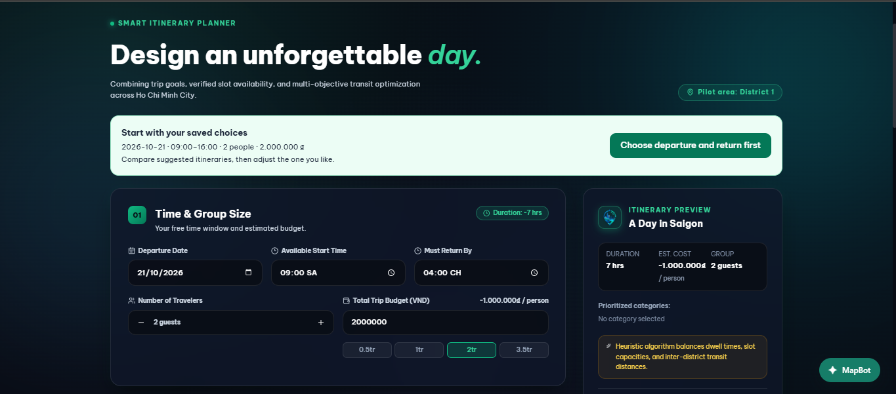
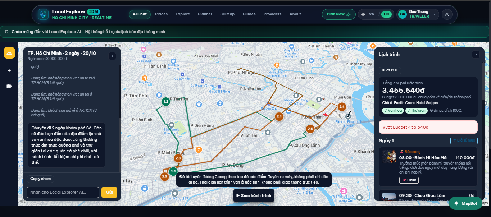
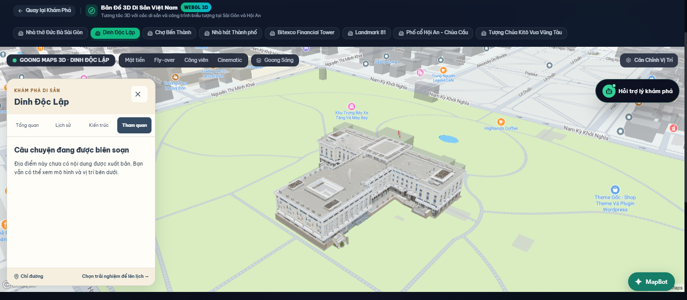
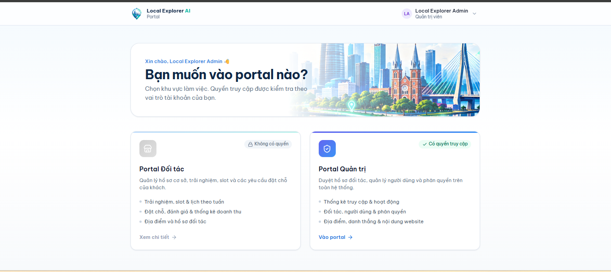
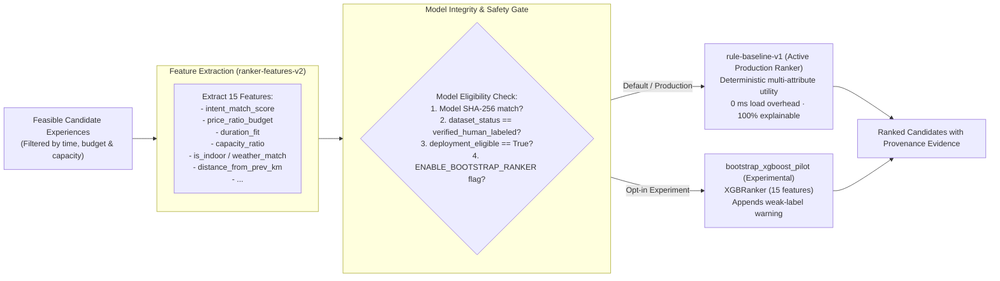

<div align="center">

<p align="center">
  
</p>

# Local Explorer AI

<p align="center">
  <b>Intelligent Urban Discovery & Slot-Aware Itinerary Planning Platform for Ho Chi Minh City</b><br/>
  <i>3D WebGL Digital Twin · Conversational AI Concierge · Deterministic Feasibility Solver · Local ML Ranker · Goong Maps Routing · B2B Tour Operator Quoting · 15-Minute Seat Holds & VNPay / MoMo Payments</i>
</p>

<p align="center">
  <a href="https://nguyentribaothang.github.io/LocalExplorerAI/">
    
  </a>
</p>

<p align="center">
  <a href="https://github.com/NguyenTriBaoThang/LocalExplorerAI/actions/workflows/ci.yml">
    
  </a>
  <a href="https://github.com/NguyenTriBaoThang/LocalExplorerAI">
    
  </a>
  <a href="https://www.localexplorerai.site/">
    
  </a>
  <a href="./LICENSE">
    
  </a>
  <a href="./docs/PROJECT_STATUS.md">
    
  </a>
  
  
  
  
</p>

<p align="center">
  <a href="http://localhost:8080/"><strong>Explore Web App</strong></a>
  &nbsp;•&nbsp;
  <a href="http://localhost:8081/"><strong>Partner & Admin Portal</strong></a>
  &nbsp;•&nbsp;
  <a href="./ARCHITECTURE.md"><strong>System Architecture</strong></a>
  &nbsp;•&nbsp;
  <a href="./MODEL_VERSIONING.md"><strong>Model Registry & ML</strong></a>
  &nbsp;•&nbsp;
  <a href="./docs/api.md"><strong>API Reference</strong></a>
  &nbsp;•&nbsp;
  <a href="./docs/PROJECT_STATUS.md"><strong>Project Status & Audit</strong></a>
</p>


</div>

---

## 📌 Executive Overview

### The Core Problem
Conventional navigation and mapping applications represent cities as static pins on flat 2D maps. However, urban travelers frequently encounter a frustrating reality: **a place being open on Google Maps does not mean you can actually participate in an experience there when you arrive.**

- Popular workshops, dining experiences, and cultural craft sessions require scheduled arrival windows and have strictly limited seat capacity.
- Assembling multi-stop plans manually ignores local traffic congestion, peak midday heat, and opening hour mismatches.
- Generic LLM chatbots frequently hallucinate non-existent attractions, outdated prices, or physically impossible transit timings.

### The Local Explorer AI Solution
Local Explorer AI pioneers a **temporal-spatial four-tier hierarchy**:

$$\text{POI (Point of Interest)} \longrightarrow \text{Experience (Activity)} \longrightarrow \text{ExperienceSlot (Time Window + Capacity)} \longrightarrow \text{Feasible Itinerary}$$

The platform guarantees **hard physical and temporal feasibility** before applying multi-objective ranking or AI personalization. If a workshop only seats 6 people, or a museum closes at 17:00, the deterministic heuristic solver will never schedule your group there at 17:15.

---

## 📸 Product Screenshots

<table align="center" width="100%">
<tr>
<td align="center" width="33%">
  
  <br/><b>3D WebGL Saigon Digital Twin</b>
</td>
<td align="center" width="33%">
  
  <br/><b>Curated Catalog & 3D Tilt Cards</b>
</td>
<td align="center" width="33%">
  
  <br/><b>Slot-Aware Route Planner</b>
</td>
</tr>
<tr>
<td align="center" width="33%">
  
  <br/><b>Laser Timeline & Road Segments</b>
</td>
<td align="center" width="33%">
  
  <br/><b>3D Landmark Viewer (GLB)</b>
</td>
<td align="center" width="33%">
  
  <br/><b>Partner Portal & Slot Management</b>
</td>
</tr>
</table>

---

## 🌟 Key System Capabilities

### 1. Spatial Experience & 3D WebGL Digital Twin
- **Three.js Cityscape (`CityHero3D`):** Procedural high-rises, neon lighting, real-time specular reflections on the Saigon River, and radar-pulse POI indicators over central District 1.
- **3D Landmark Viewer (`/map-3d`):** Interactive inspection of architectural heritage (Notre Dame Cathedral, Ben Thanh Market, Bitexco, Landmark 81) using GLTF/GLB models with calibrated GPS heading, scale, and altitude.
- **Meshy AI Generative 3D:** Integrated background worker generating 3D digital twin assets from prompts and reference imagery via Meshy.ai.

### 2. Conversational AI Concierge & Prompt Catalog v3.2.0
- **Natural Language Parsing in Vietnamese:** Accepts complex travel prompts (e.g. *"2 người đi làm gốm Quận 1 từ 9h đến 16h ngân sách 1 triệu bằng xe máy"*).
- **Structured Extraction:** Built on versioned prompt workflows (`apps/api/app/prompts/v3_2_0/`), extracting budget, group size, time windows, and intent weights without rigid forms.
- **Deterministic Clarification & Fallback:** If required constraints are omitted, the conversational engine prompts with interactive response chips. In offline or unconfigured states, a local heuristic fallback guarantees continuous operation.

### 3. Deterministic Heuristic Route Planner
- **Multi-Objective Optimization:** Evaluates travel friction, opening hours, user intent alignment (Culture, Food, Craft, Relaxation), and midday heat avoidance.
- **Locked Stops Preservation:** Pinned stops selected by travelers are strictly respected and cannot be reordered or removed by automated replanning.
- **Goong Maps Integration:** Turn-by-turn road route segments, accurate distance matrix computation, and decoded route polylines.

### 4. B2B Tour Operator Quoting & Pricing Engine
- **Automated Quotation Generation:** Transforms raw tour requests into itemized B2B quotations factoring in vehicle rentals, tour guides, entrance fees, and meals from supplier rate cards.
- **Machine Learning Win Optimizer:** Utilizes an XGBoost classifier (`quote-win-xgb-synthetic`) to estimate customer acceptance probability $P(\text{win})$ and suggest balanced profit-maximizing markups.
- **Financial Margin Guardrails:** Prevents negative or below-floor margin quotes; tracks quote-to-actual financial reconciliation to identify supplier cost leakages.

### 5. Two-Phase Booking Commerce & Payments
- **15-Minute Optimistic Seat Holds:** Locks slot capacity with optimistic database concurrency (`version` tracking), preventing double-booking during checkout.
- **Payment Gateway Integrations:** Production-ready adapters for **VNPay** (HMAC-SHA512) and **MoMo** (HMAC-SHA256) with cryptographic IPN signature validation.

### 6. Enterprise Security, RBAC & Multi-Tenancy
- **Stateless RS256 JWT & Rotating Refresh Cookies:** HTTP-only, `SameSite=Lax` cookie architecture with instant replay detection and token family revocation.
- **Multi-Factor Authentication (MFA):** RFC 6238 TOTP with QR code setup and encrypted backup recovery codes, mandatory for administrators in production.
- **Argon2id Password Hashing:** Industry-standard password hashing with automatic rehash upgrades for legacy credentials.
- **Fernet Vault Encryption:** Dynamic integration keys (Goong, VNPay, MoMo, OpenAI) are encrypted at rest using AES-128-CBC.

---

## 🏛️ System Architecture

```mermaid
flowchart TB
    subgraph Clients["Frontend Applications"]
        Web["Traveler SPA (apps/web :8080)\nReact 18.3 · Vite 6 · Three.js · Leaflet"]
        Portal["Partner & Admin Portal (apps/portal :8081)\nReact 18.3 · Vite 6 · Tailwind"]
        Docs["Docs Site (docs-site :5173)\nGitHub Pages Static Portal"]
    end

    subgraph SecurityMW["Security & Protection Middleware"]
        MW1["X-Request-ID Tracking & Structured Logging"]
        MW2["CORS & CSRF Origin Verification"]
        MW3["Rate Limiting Guard (Redis / Local Fallback)"]
    end

    subgraph API["FastAPI Backend (apps/api :8000)"]
        R_Auth["Auth, MFA & RBAC Routers"]
        R_Cat["Catalog & Places Admin Routers"]
        R_Plan["Planner, Trips & Routing Routers"]
        R_AI["AI Concierge & v3.2.0 Prompt Engine"]
        R_ML["Machine Learning & Ranker Gate"]
        R_Op["Tour Operator Quoting & Pricing Routers"]
        R_Comm["Bookings, Payments & Reviews Routers"]
    end

    subgraph Services["Domain Services & Engines"]
        HeuristicSolver["Deterministic Heuristic Planner"]
        PromptEngine["Structured Prompt Runner (Instructor)"]
        ActiveRanker["Active Experience Ranker (rule-baseline-v1)"]
        QuoteEngine["Cost Engine & Margin Guard"]
        BookingEngine["Seat Hold & Ticket Engine"]
        MeshyWorker["Meshy 3D Asset Worker"]
        OutboxWorker["Notification Outbox Worker (worker.py)"]
    end

    subgraph Storage["Data & Model Storage"]
        Postgres[("PostgreSQL 16 + PostGIS 3.4\n(or SQLite in local dev)")]
        RedisCache[("Redis 7.0 (Optional)\nRate Limit & Session Cache")]
        ModelReg[("Model Registry\nmodels/ai-ranker, models/quote-win")]
    end

    subgraph Cloud["External Gateways"]
        Goong["Goong Maps API"]
        OpenMeteo["Open-Meteo Weather & AQI"]
        LLM["OpenAI / Gemini LLMs"]
        Gateways["VNPay & MoMo Gateways"]
        MeshyCloud["Meshy.ai 3D Cloud"]
    end

    Clients --> SecurityMW --> API
    API --> Services
    Services --> Storage
    Services --> Cloud
```



---

## 💻 Technology Stack

| Layer | Technology | Primary Function |
|---|---|---|
| **Traveler Frontend** | React 18.3, TypeScript 5.6, Vite 6 | High-performance single page web application |
| **Geospatial & 3D** | Three.js (0.162), Leaflet, CartoDB, Goong JS | WebGL Saigon digital twin, 3D GLB landmarks, interactive routing map |
| **Styling & UI** | Tailwind CSS, Lucide React, Glassmorphism CSS | Responsive dual themes (Warm Light / Emerald Dark), 3D TiltCards |
| **Partner & Admin Portal** | React 18.3, Vite 6, Tailwind CSS | Multi-tenant portal for experience providers, tour operators, and admins |
| **Backend API** | FastAPI (0.142+), Uvicorn, Pydantic v2 | High-throughput asynchronous ASGI microframework |
| **Database & ORM** | PostgreSQL 16, PostGIS 3.4, SQLAlchemy 2.0 | Spatial geometry queries (`POINT`), optimistic locking, multi-tenant tables |
| **Schema Migrations** | Alembic (30 verified revisions) | Versioned database schema evolution |
| **Authentication & Crypto** | PyJWT (RS256), Argon2-cffi, PyOTP, Fernet | Cryptographic tokens, password hashing, TOTP 2FA, secret vault |
| **Machine Learning** | XGBoost, Scikit-learn, Sentence-Transformers | Tour win optimization, offline ranking experiment, E5 vector embeddings |
| **External Integrations** | Goong API, Open-Meteo, VNPay, MoMo, Meshy | Mapping, weather forecasting, payment processing, 3D model generation |
| **DevOps & Containers** | Docker, Docker Compose v2, Nginx | Multi-container deployment with health monitoring and persistent volumes |

---

## 🤖 AI & Machine Learning Pipeline



### Model Governance & Real Status
- **`rule-baseline-v1` (Active Production):** Pure Python deterministic ranker balancing user intent weights and travel efficiency. Zero disk overhead, fully verified.
- **`bootstrap_xgboost_pilot` (Experimental):** Staged in `models/ai-ranker/`. Trained on weak scenario labels (`NDCG@5 = 0.6667`). Blocked from production deployment by default.
- **`quote-win-xgb-synthetic` (Experimental):** Staged in `models/quote-win/`. XGBoost model for tour operator quote win probability ($AUC = 0.7372$). Backtested with +9.5% profit gain over fixed markups.
- **`multilingual-e5-small` (Implemented):** Dense vector search (`intfloat/multilingual-e5-small`). Weights excluded from git and downloadable via `python -m scripts.download_e5_model`.
- **Saigon Flood Risk Classifier (Research):** Weather-to-flood risk classifier in `models/dataset-17-experiment/`. Lacks real sensor labels; road routing currently uses deterministic rainfall thresholds.

*Read the full policy in [MODEL_VERSIONING.md](./MODEL_VERSIONING.md).*

---

## 🚦 Verified System Status & Progress

The platform has undergone rigorous automated testing across both frontend and backend suites:

| Module | Features / Capabilities | Status | Test & Execution Evidence |
|---|---|---|---|
| **apps/web** | 3D Cityscape, Planner, Explore, Chat, Compare, Places, Themes, PWA | **VERIFIED** | `apps/web/scripts/test-trip.mjs` (**18/18 pass**), Vite build clean (code 0) |
| **apps/portal** | Partner onboarding, slot capacity management, Admin moderation, RBAC | **VERIFIED** | `tsc -b && vite build` completed with **exit code 0** (2,073 modules) |
| **docs-site** | Showcase documentation site, architecture diagrams, API explorer | **VERIFIED** | `tsc -b && vite build` completed with **exit code 0** (1,599 modules) |
| **Auth & Security** | RS256 JWT, Argon2id passwords, TOTP MFA, Account recovery | **VERIFIED** | `pytest tests/auth/` & `tests/test_account_recovery.py` (**106/106 pass**) |
| **AI Prompt Engine** | Prompt catalog v3.2.0 (20 workflows), offline chat fallback | **VERIFIED** | `pytest tests/test_ai_workflows.py` (**5/5 pass**) |
| **Planner Core** | Deterministic heuristic solver, multi-objective constraints, locked stops | **VERIFIED** | `pytest tests/test_planner.py` (**11/11 pass**) |
| **Trip Workflows** | Multi-turn conversational planning via SSE, replanning, road legs | **VERIFIED** | `pytest tests/trip/` (**252/252 pass**) |
| **B2B Operator** | Tour quoting, rate cards, win-probability optimizer, margin guard | **VERIFIED** | `pytest tests/test_operator_quotes.py` & pricing (**31/31 pass**) |
| **ML Runtime** | Rule baseline v1, weak-label gate validation, feature schema | **VERIFIED** | `pytest tests/test_ml_models.py` (**12/12 pass**) |
| **Payment Adapters**| VNPay (HMAC-SHA512) & MoMo (HMAC-SHA256) IPN verification | **IMPLEMENTED** | `tests/test_momo.py` passing; requires live staging credentials for smoke |
| **Goong Routing** | Goong Directions & Forward Geocoding with memory TTL cache | **IMPLEMENTED** | Tested with mock fixtures; live key required for real road geometry |

*Detailed test breakdown available in [docs/PROJECT_STATUS.md](./docs/PROJECT_STATUS.md).*

---

## 🚀 Quick Start Guide

### Prerequisites
- **Git** with Git LFS
- **Node.js** `20.x` or higher and **npm** `10.x`
- **Python** `3.12` or `3.13`
- *(Optional)* **Docker** & **Docker Compose v2**

---

### Option A: Running with Docker Compose (Recommended)

1. **Clone the repository:**
   ```bash
   git clone https://github.com/NguyenTriBaoThang/LocalExplorerAI.git
   cd LocalExplorerAI
   ```

2. **Configure environment:**
   ```bash
   cp .env.example .env
   ```

3. **Start all services:**
   ```bash
   docker compose up --build
   ```

4. **Access the applications:**
   - **Traveler Web App:** `http://localhost:8080`
   - **Partner & Admin Portal:** `http://localhost:5174` (or configured `PORTAL_PORT`)
   - **Backend API Docs:** `http://localhost:8000/docs`

---

### Option B: Manual Local Development

#### 1. Setup Backend API (`apps/api`)
```powershell
cd apps/api

# Create and activate virtual environment
python -m venv .venv
.\.venv\Scripts\Activate.ps1

# Install dependencies
pip install -r requirements.txt

# Configure environment
cp ..\..\.env.example .env

# Generate required RS256 auth keys
python -m scripts.generate_auth_keys

# Run database migrations
alembic upgrade head

# Start API server
uvicorn app.main:app --reload --host 0.0.0.0 --port 8000 --no-access-log --ws-max-size 65536
```

#### 2. Setup Traveler Web App (`apps/web`)
```powershell
cd apps/web

# Install dependencies
npm ci

# Run unit tests
npm run test

# Start development server
npm run dev
# Open http://localhost:8080
```

#### 3. Setup Partner & Admin Portal (`apps/portal`)
```powershell
cd apps/portal

# Install dependencies
npm ci

# Start portal dev server
npm run dev
# Open http://localhost:8081
```

#### 4. Running Backend Tests
```powershell
cd apps/api
$env:APP_ENV="test"
pytest -p no:cacheprovider -q
```

---

## 📁 Repository Directory Structure

```text
LocalExplorerAI/
├── .github/                   # CI/CD workflows (ci.yml, deploy-pages.yml)
├── apps/
│   ├── api/                   # FastAPI backend application
│   │   ├── alembic/           # Alembic config
│   │   ├── app/               # Core application modules
│   │   │   ├── adapters/      # External integrations (Goong, VNPay, MoMo, Meshy)
│   │   │   ├── api/           # HTTP routes (33 routers), dependencies, permissions
│   │   │   ├── core/          # Configuration, security, client IP, logging
│   │   │   ├── models/        # SQLAlchemy ORM models (entities, auth_entities)
│   │   │   ├── prompts/       # Versioned prompt catalog (v3.0.0, v3.1.0, v3.2.0)
│   │   │   ├── schemas/       # Pydantic v2 validation contracts
│   │   │   └── services/      # Planner, ranking, quote engine, sessions
│   │   ├── migrations/        # 30 Alembic database revisions
│   │   └── tests/             # Comprehensive pytest test suite (766 tests)
│   ├── portal/                # React/Tailwind Partner & Admin Portal
│   └── web/                   # React/Three.js/Leaflet Traveler Application
├── assets/                    # Screenshots, logos, architecture diagrams
├── data/                      # Datasets, raw inputs, portable catalog, experimental data
├── docs/                      # Technical documentation, API reference, data models
├── docs-site/                 # Vite-based static documentation website
├── models/                    # Model artifacts (ai-ranker, quote-win, e5, flood-risk)
├── scripts/                   # DB seed scripts, key generators, test harnesses
├── ARCHITECTURE.md            # Comprehensive 7-diagram architecture specification
├── MODEL_VERSIONING.md        # Machine learning & heuristic versioning policy
├── docker-compose.yml         # Container orchestration manifest
├── package.json               # Root monorepo workspace configuration
└── README.md                  # Project overview (this file)
```

---

## ⚠️ Known Boundaries & Current Limitations

1. **Third-Party API Credentials:**
   - Real-time road polylines from Goong, LLM completions from OpenAI/Gemini, and online payment checkouts require active third-party credentials configured in `.env`. When unconfigured, the system gracefully utilizes robust offline heuristic fallbacks.
2. **Weak-Labeled & Synthetic ML Artifacts:**
   - The current XGBoost experience ranker was trained on weak bootstrap scenario labels; it is kept in an experimental mode and blocked from production deployment by default.
   - The tour operator quote win-probability model is trained on 21,980 synthetic quote records. Live pricing should be recalibrated on historical operator booking data.
3. **Road Flood Model Status:**
   - There is currently no verified machine learning model trained on real street flooding sensors in Ho Chi Minh City. The weather advisory workflow evaluates rainfall intensity (mm/h) heuristically.

---

## 🗺️ Development Roadmap

### Completed (v1.0 - Current)
- [x] Three-tier temporal data model (POI $\rightarrow$ Experience $\rightarrow$ Slot $\rightarrow$ Itinerary).
- [x] Three.js 3D WebGL Saigon Cityscape & GLB 3D Landmark Viewer.
- [x] Multi-turn conversational AI Concierge with streaming SSE events and v3.2.0 prompt catalog.
- [x] Deterministic heuristic multi-objective planner with locked-stop preservation.
- [x] B2B Tour Operator quoting, rate cards, and financial margin guardrails.
- [x] 15-minute optimistic seat holds and VNPay / MoMo payment integration code.
- [x] Dedicated Partner & Admin Portal with RBAC, session rotation, and TOTP MFA.
- [x] 30 Alembic database migrations and 346+ automated unit/integration tests.

### In Progress (v1.1)
- [ ] Staging end-to-end smoke testing with live VNPay & MoMo sandbox credentials.
- [ ] Consented traveler telemetry ingestion for human-labeled experience ranking.
- [ ] Automated PDF export for B2B tour quotations and traveler itinerary receipts.

### Planned (v2.0)
- [ ] Native mobile apps (React Native / Flutter) leveraging shared API contracts.
- [ ] Real-time IoT sensor ingestion for automated flood route detour recalculations.
- [ ] Multi-city expansion beyond Ho Chi Minh City (Da Nang, Hanoi, Hue, Hoi An).

---

## 📚 Technical Documentation Index

- **[System Architecture (ARCHITECTURE.md)](./ARCHITECTURE.md)** — Complete 7-diagram end-to-end architecture specification.
- **[Model Versioning Policy (MODEL_VERSIONING.md)](./MODEL_VERSIONING.md)** — Model registry, feature contracts, and promotion gates.
- **[Project Status & Audit (docs/PROJECT_STATUS.md)](./docs/PROJECT_STATUS.md)** — Comprehensive feature matrix, test counts, and verification evidence.
- **[API Reference (docs/api.md)](./docs/api.md)** — Complete endpoint specification covering all 33 router modules.
- **[Traveler Web Application (apps/web/README.md)](./apps/web/README.md)** — Frontend architecture, routes, state management, and 3D WebGL.
- **[FastAPI Backend (apps/api/README.md)](./apps/api/README.md)** — Backend architecture, services, database migrations, and pytest setup.
- **[Partner & Admin Portal (apps/portal/README.md)](./apps/portal/README.md)** — Dedicated portal workflow, slot management, and moderation.
- **[Documentation Site (docs-site/README.md)](./docs-site/README.md)** — Static documentation showcase deployable on GitHub Pages.

---

## 🤝 Contributing, Security & License

- **Contributing:** Please read [CONTRIBUTING.md](./.github/CONTRIBUTING.md) and adhere to [Conventional Commits](https://www.conventionalcommits.org/).
- **Code of Conduct:** Review our community guidelines in [CODE_OF_CONDUCT.md](./.github/CODE_OF_CONDUCT.md).
- **Security Policy:** Report vulnerabilities responsibly following [SECURITY.md](./.github/SECURITY.md).
- **License:** Licensed under the [MIT License](./LICENSE). Copyright © 2026 Local Explorer AI Team.
