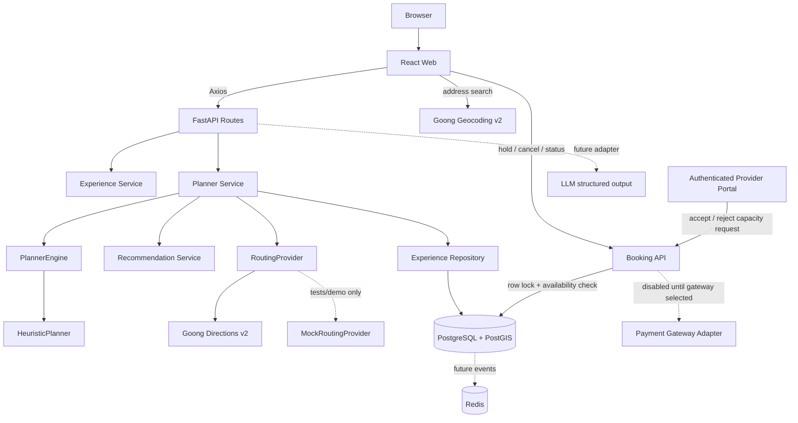

# Architecture

## Components

- **Web**: React + TypeScript + Vite; Explore, Planner, itinerary, provider portal, admin, and About pages. Axios is centralized under `src/api`; Leaflet is accessed only through `MapAdapter`.
- **API**: FastAPI routes receive/validate requests, then delegate to services. Pydantic defines contracts and error responses with request IDs.
- **Services**: `ExperienceService`, `RecommendationService`, `PlannerService`, `ExplanationService`, and `evidence_service`; the Planner coordinates repositories, source/expiry checks, routing, and the engine.
- **Planner engine**: `PlannerEngine` is an interface; `HeuristicPlanner` selects the earliest feasible slot, then prioritizes intent when times are equal. An OR-Tools engine could be added without changing the route contract.
- **Repository**: SQLAlchemy queries for the catalog and slots, separating persistence details from routes.
- **Database**: PostgreSQL + PostGIS; latitude/longitude serve API responses while `pois.geom geography(POINT,4326)`/GIST is available for future spatial queries.
- **Routing/geocoding adapters**: `RoutingProvider` uses `GoongDirectionsProvider` when `ROUTING_PROVIDER=goong` (the local/production default), `GoongGeocodingProvider` for user-entered addresses, and `MockRoutingProvider` only for tests/explicit demos. Goong returns distance, duration, and route geometry; each leg carries its source, calculation time, cache TTL, and `is_realtime=false`. Live-traffic ETA is not provided.
- **Redis**: included in Compose and health checks; it is not currently used for cache, queue, or event consumption.
- **Map adapter**: Leaflet + OpenStreetMap in the demo. The map SDK does not contain business logic.

## Planning Flow

1. Request datetimes must include an offset; the planner normalizes timestamps for comparison/storage in UTC.
2. Filter slots to the trip window; remove canceled/full slots and slots where `available_reported` is below the group size.
3. Calculate cost using `price_basis`; remove experiences that exceed the remaining budget.
4. Geocode entered addresses into coordinate options with source/time/expiry; for each candidate, get Goong route estimates for the outbound and return legs. Only consider slots starting after the ETA and itineraries returning before the deadline.
5. The engine selects a feasible slot; rationale, preserved/lost intents, uncertainty, ETA source/age, and encoded route geometry are included in the response.
6. For the operational catalog, the Planner only uses POIs/experiences with sufficient approved evidence and slots with unexpired confirmation. It persists the itinerary, stops, and DecisionLog. Unknown slot capacity is not treated as zero; the itinerary becomes `tentative`.

## Trust Boundaries

Seed POIs/experiences/slots and the 10 web fallback POIs are simulated data; the UI labels them as simulated and does not let administrators approve them as real without evidence. Providers can submit POIs/experiences and sources for admin review; a slot is a venue-reported availability with a confirmation time and expiry, not a booking. Routes and ETAs use Goong when a key is configured, but the ETA is not live traffic; there is no simulated fallback when the provider fails. Goong modes currently map motorcycle/walking/car to the `bike`/`foot`/`car` profiles. Because the Directions V2 parameter table and Goong's capability description are not fully consistent, smoke-test with a real API key/account before the pilot. Transit/bicycling are not supported by the Goong adapter. The pilot scale in the draft (20–30 POIs, 10–15 experiences, 30–50 slots, outreach to 3–5 venues) has not been reconfirmed by the team and is not hard-coded; see [sourced catalog workflow](sourced-catalog.md).
